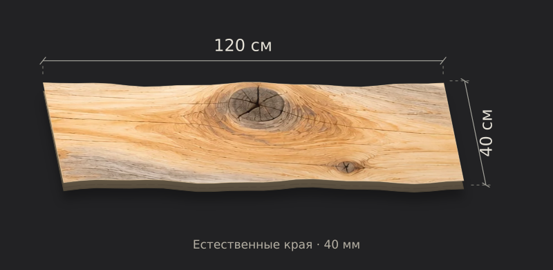

# Аудит изображений KELO WOOD MARKET

Дата: 1 ноября 2026 года. База GitHub до задачи: `2158285187a48790ac67a263da0a05ab880c821d`.

## Результат

**Проверены 33 уникальных полноразмерных статических изображения:** 30 используемых фото древесины, 1 пейзаж и 2 неиспользуемых старых файла. Обнаружено 15 проблем формы/толщины и 5 проблем отделки верхней пласти. **Все 20 уникальных изображений заменены, интегрированы и визуально просмотрены.** Обновлены 14 производных миниатюр; они не увеличивают число уникальных исправлений.

Использован встроенный ImageGen. Pillow применялся для механического кодирования в WebP, уменьшения миниатюр и контактных листов QA. Точные окончательные промпты, SHA-256 до/после и места использования сохранены в [board-image-prompts.json](board-image-prompts.json). Неудачные промежуточные варианты в число исправлений не включены.

## Перечень замен

| Изображение | Причина | Использование |
|---|---|---|
| `public/images/board.webp` | Грубая верхняя поверхность | Редактор /constructor: текстура схемы под ползунком; миниатюры товаров в админке |
| `public/images/gallery/blanks-end.webp` | Форма или чрезмерная толщина | Галереи заготовок: /product/[id], выбор товара, корзина и оформление |
| `public/images/gallery/blanks-sill.webp` | Форма или чрезмерная толщина | Галереи заготовок: /product/[id], выбор товара, корзина и оформление |
| `public/images/gallery/blanks-stack.webp` | Форма или чрезмерная толщина | Галереи заготовок: /product/[id], выбор товара, корзина и оформление |
| `public/images/gallery/blanks-workshop.webp` | Форма или чрезмерная толщина | Галереи заготовок: /product/[id], выбор товара, корзина и оформление |
| `public/images/gallery/home-grain.webp` | Грубая верхняя поверхность | Главная: «Характер. В деталях» |
| `public/images/gallery/home-hero.webp` | Форма или чрезмерная толщина | Главная: первый экран |
| `public/images/gallery/material-thickness.webp` | Форма или чрезмерная толщина | Главная: блок о толщине материала |
| `public/images/gallery/shelves-angle.webp` | Форма или чрезмерная толщина | Галереи полок: /product/[id], выбор товара, корзина и оформление |
| `public/images/gallery/shelves-edge.webp` | Форма или чрезмерная толщина | Галереи полок: /product/[id], выбор товара, корзина и оформление |
| `public/images/gallery/shelves-grain.webp` | Грубая верхняя поверхность | Галереи полок: /product/[id], выбор товара, корзина и оформление |
| `public/images/gallery/shelves-room.webp` | Форма или чрезмерная толщина | Галереи полок: /product/[id], выбор товара, корзина и оформление |
| `public/images/gallery/slabs-angle.webp` | Форма или чрезмерная толщина | Галереи слэбов: /product/[id], выбор товара, корзина и оформление |
| `public/images/gallery/slabs-knot.webp` | Грубая верхняя поверхность | Галереи слэбов: /product/[id], выбор товара, корзина и оформление |
| `public/images/gallery/slabs-top.webp` | Грубая верхняя поверхность | Галереи слэбов: /product/[id], выбор товара, корзина и оформление |
| `public/images/hero.webp` | Форма или чрезмерная толщина | Исходное фото товара в админке |
| `public/images/quiet-blanks.webp` | Форма или чрезмерная толщина | Галереи заготовок: /product/[id], выбор товара, корзина и оформление |
| `public/images/quiet-hero.webp` | Форма или чрезмерная толщина | Галереи слэбов: /product/[id], выбор товара, корзина и оформление |
| `public/images/quiet-shelf.webp` | Форма или чрезмерная толщина | Галереи полок: /product/[id], выбор товара, корзина и оформление |
| `public/images/shelf.webp` | Форма или чрезмерная толщина | Исходное фото полки в админке |

## Сохранённые изображения

Без изменений оставлены `gallery/blanks-top.webp`, `gallery/home-edge.webp`, `gallery/material-edge.webp`, `gallery/slabs-edge.webp`, `gallery/home-shelf.webp`, `gallery/material-long.webp`, `gallery/project-console.webp`, `gallery/project-window.webp`, `gallery/shelves-front.webp`, `interior.webp`, пейзаж `forest.webp` и неиспользуемые `gallery-hero.webp`, `gallery-macro.webp`. Крупный план естественного края сам по себе не доказывает чрезмерную толщину; такие фото не заменялись ради единообразия. Исходные картинки товаров в админке тоже проверены.

## Доска в блоке с ползунком

По отдельному уточнению пользователя схема в `/constructor` заменена новым `components/board-preview.tsx`: плоская полированная пласть с фактурой без растяжения, тонкий профиль по толщине 30/40 мм, природные боковые линии, отверстия и выбранная сторона прямого спила. Длина и ширина сохраняют реальные пропорции. Это статическая SVG-схема; 3D/GLB не включались.

Показ полного кадра через `object-fit:contain` добавлен к карточке доски, главным изображениям галерей, «Характеру в деталях», корзине и оформлению; контейнеры/сетка сохраняются. Миниатюры остаются компактными.

## Выполненные проверки

- Каждое из 20 окончательных изображений просмотрено визуально, включая видимые плоскости, края и торцы. Итоговая подборка из всех 33 фото сверена повторно.
- Все WebP читаются декодером; полноразмерные замены имеют 1536 × 1024 px. У каждого изменённого изображения проверено отличие SHA-256 от исходника. Корректные 13 изображений не изменены.
- `tsc --noEmit` — успешно.
- Существующие 22 теста commerce/gallery-gestures/length-detents/board-model — успешно.
- Четыре отдельных SVG-рендера проверены для 120×40×40, 30×40×30, 150×10×40 и будущего 20×40×40: размеры, число отверстий, спил и границы. Это не изменение текущего минимального заказа 30 см.
- Сборка Vinext/Vite прошла. Финальный архив публикации должен собираться после всех замен, чтобы включить последние WebP.
- История исходников и синхронизация в GitHub выполняются через source helper и проверку равенства дерева по `AGENTS.md`. Факт публикации подтверждается результатом Sites; текущие SHA видны в истории коммитов.

## Ограничения и оставшаяся проверка

**Полная проверка страницы на мобильном и десктопе не выполнена.** `sites-preview start/status` вернул отсутствие mailbox службы preview. Опубликованный Site открыл страницу входа. Автоматическая проверка отклонила нажатие «Продолжить через ChatGPT», указав на неподтверждённое разрешение на вход. Этот запрет не обходился. Вёрстка исследована по CSS и отдельным SVG-рендерам; это не выдаётся за проверку живых страниц.

Невидимая нижняя поверхность на большинстве фото не показана. Можно проверить видимые плоскости и отсутствие наплывов, но нельзя доказать полировку скрытого низа или физические размеры по сгенерированной фотографии. Все изображения остаются демонстрационными.

Файлы изображений, загруженные владельцем в R2, не выгружались и не проверялись; содержимое пользовательского хранилища в аудит статических исходников не входит. Перед продажами нужна проверка реальных фото.

После разрешённого входа: открыть главную, `/catalog`, `/constructor`, галереи всех 8 товаров, корзину/checkout на ширинах 390 и 1440 px; проверить отсутствие горизонтального переполнения, корректное кадрирование, листание, загрузку всех миниатюр и факт выдачи новых изображений. Остальные несогласованные требования — в [OPEN_TASKS.md](OPEN_TASKS.md).
